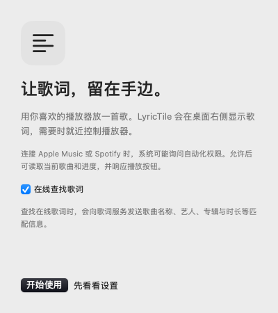

# 实际 macOS 验证记录 · 2026-11-26

**源码提交：[`75d9e60cb8a0`](https://github.com/haohongfei2001-png/nearpane/commit/75d9e60cb8a0eced93ed1c01f99ee109c315a7fe)。** [完整工作流](https://github.com/haohongfei2001-png/nearpane/actions/runs/45750660678) · [候选 ZIP/DMG 与完整日志](https://github.com/haohongfei2001-png/nearpane/actions/runs/45750660678/artifacts/15085886100)。

这是原生工程候选的可复核证据。四播放器正式支持、用户本机、独立时间精度与最终发行资格分别记录，不能由 CI 绿色推导。后续纯文档提交不改变这里所标识的已测源码与候选包。

## 本次实际结果

| 项目 | 观察结果 |
|---|---|
| 实际主机 | macOS 27.0.1（26A434），arm64 |
| 实际工具链 | Xcode 27.1（27A9275），Swift 6.4；见 [host.txt](host.txt) |
| 原生编译 | 独立 LyricTile App 与 NearpaneLyricsModule 均通过 |
| 自动化测试 | 65 个通过：XCTest 10 + Swift Testing 55；零失败、零跳过 |
| 安装包 | App、ZIP、DMG 构建成功；arm64、资源、framework rpath、Automation entitlement 与 ad-hoc 签名完整性通过 |
| 生产 UI | 空态歌词板 176×62 pt、欢迎页 400×450 pt、设置页 450×620 pt 均打开、挂载、保存真实内容位图；正常退出码 0 |
| MediaRemote | 包内真实 helper 执行只读 get，返回 `null`；17 个私有符号解析成功；范围是 helper_load_only |
| 空闲 CPU | 0.2330% 单核；目标 ≤0.3% |
| 空闲 RSS 中位 / 峰值 | 61.61 / 61.62 MiB；目标 ≤120 / ≤180 MiB |
| 空闲预算判断 | 本次 hosted idle 样本达到预算 |

空闲测量使用正常生产 app：无目标播放器、无歌曲、关闭在线歌词、正常完成启动并经过 15 秒自动隐藏，再做约 120 秒进程树采样。CPU 采用累计 CPU 时间差除以实际单调时间，单核 100%；`ps` 有有限时间分辨率，瞬时子进程可能漏采。完整样本与限制保存在 [idle-check.json](idle-check.json) 和 [idle-summary.json](idle-summary.json)。这不是 M5 实测，也不是逐行、逐字或八小时结论。

## 真实原生界面

图像由已经打开的生产 `NSView.cacheDisplay` 直接捕获，没有注入歌曲或歌词。这验证内容渲染，不认证桌面合成器的玻璃材质、真实歌词排版或 TCC。实际渲染图已人工检查，文字与控件正常；设置页为系统可滚动 Form。

[空态歌词板](native-empty-panel.png) · [欢迎页](native-welcome.png) · [设置页](native-settings.png)

## 候选文件

| 文件 | 大小 | SHA256 |
|---|---:|---|
| `LyricTile-1.0.0-candidate-arm64.dmg` | 4,196,589 bytes | `4152859c0bf21f308b15692e5b88402fece2f445e2970ad5d34c27925832c390` |
| `LyricTile-1.0.0-candidate-arm64.zip` | 3,819,078 bytes | `54092f4a436fb469c53ab1a40665b78b4f6d355c218dcda4a4c42e81631c7bd4` |

下载的 Actions artifact SHA256：`959287ae135650e285ec98cac5293cd4bedc52263b0facfaf3ba151ec448f3bf`。已核对 artifact 摘要，以及内部 ZIP/DMG 与 [CANDIDATE-SHA256SUMS](CANDIDATE-SHA256SUMS) 一致；还核对实际 ZIP 包含 Yams、Sparkle、mediaremote-adapter 与 libyaml 的完整 notice 文件。Actions 的二进制与完整构建日志保留 30 天；本目录的精简证据与完整源码在分支中保存，候选可按脚本重建。

当前签名为 **ad-hoc**。Developer ID、Apple 公证、最终 Gatekeeper 接受和真实 Sparkle 升级均未执行。

## 证据索引与边界

- [verification.json](verification.json)：本次摘要、commit、run、artifact、文件哈希、测试数及 NOT_RUN 项。
- [test-results.xml](test-results.xml) / [test-results-swift-testing.xml](test-results-swift-testing.xml)：原始测试结果。
- [bundle-verification.json](bundle-verification.json)：实际打包与签名完整性检查。
- [native-smoke.json](native-smoke.json) / [退出日志](native-smoke.stderr.log)：三个生产界面及真实退出链。
- [media-helper-load.json](media-helper-load.json)：17 个符号和真实 `get` 输出；未调用播放控制，也没有声明 QQ/网易支持已通过。
- [prior-idle-ci6.json](prior-idle-ci6.json)、[prior-idle-ci7.json](prior-idle-ci7.json)、[prior-idle-ci8.json](prior-idle-ci8.json)：此前超预算/未执行结果一并保存。不同 hosted 运行不能当作受控性能对比；CI6 使用较早的区间均值方法。
- [CHECKSUMS.sha256](CHECKSUMS.sha256)：本目录精简证据的摘要。

本机剩余执行入口是 [LOCAL_ONLY_HANDOFF.md](../../LOCAL_ONLY_HANDOFF.md)。正式支持清单由真实四播放器、权限、时钟、双屏、长期使用和最终签名包的结果决定。
