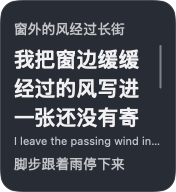
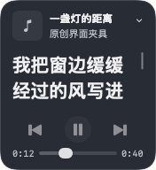
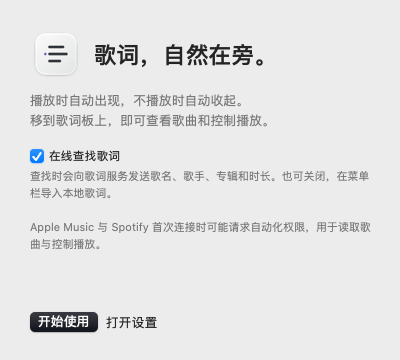
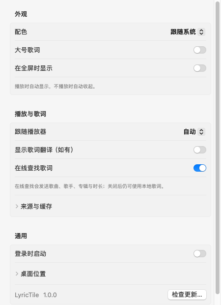

# LyricTile · 2026-11-27 界面精修

源码与测试：[`8079441`](https://github.com/haohongfei2001-png/nearpane/commit/8079441ad2e59da63ebbdb606a201abfa6cc5092)。[原生 CI35](https://github.com/haohongfei2001-png/nearpane/actions/runs/45935989967) 全部通过，十种原生布局与两张辅助窗口截图已复审。机器可读结果、文件哈希和证据边界见 [verification.json](verification.json)。此前界面证据保持不变。

## 最终设计裁决

| 情况 | 呈现 |
|---|---|
| 正在播放，当前句一至两行 | 固定 192pt，当前句加前后各两句，共五句布局 |
| 正在播放，当前句较长 | 固定 192pt，前后各保留一句，为当前句让出三至四个完整文字行；不缩字号 |
| 正在播放，歌词查找中或不可用 | 104pt 紧凑摘要，显示真实歌曲信息和简短状态 |
| hover | 原外框内显示封面、标题、歌手、播放控制与进度；主句最多两完整行，不与控件重叠 |
| 暂停且仍在实际操作面板 | 保持当时的显示形态，暂缓尺寸切换；离开后隐藏，恢复播放后使用最新歌词 |
| 无歌曲、停止、缓冲或未知状态 | 隐藏面板并释放侧栏注册，菜单栏入口保留 |

短句保留已有五句层次，长句优先使用空间。字体、原生换行和 5pt 溢出指示预留由同一 CoreText 排版计算；极端长句仍可滚动。hover 前后当前句中心最多相差原生像素取整的 0.5pt，外框不变化。翻译保留单行，完整内容可通过原生提示查看。

侧栏实际占位跟随 104/192pt。收缩等待一秒合并短暂查找状态，之后回收此前 88pt 空位；扩容先撤回，再取得现有 registry 的新授权。用户排列顺序不变，旧尺寸授权不能用于更大窗口。

## 原生布局截图

| 阅读态 | hover |
|---|---|
|  |  |
|  |  |
|  |  |
|  |  |

另含缺失元数据与无歌曲透明根视图。缺失封面使用中性符号，歌手缺失时省略，未知时间显示 `—:—`；真实字段沿用既有播放器数据。

欢迎页收紧为 400×360；在线查找开关与传输信息告知放在一起，没有加入演示歌曲。设置保持原生表单，按外观、播放与歌词、通用分组，低频桌面位置选项折叠。

| 欢迎 | 设置 |
|---|---|
|  |  |

## 验证结果与边界

- macOS 27.0.1 arm64、Xcode 27.1、Swift 6.4；生产 app 与宿主 facade 编译通过。
- [Swift Testing](test-results-swift-testing.xml) 76 个测试定义、[XCTest](test-results.xml) 15 个用例全部通过。原生布局参数化覆盖十个场景；新增暂停时歌词到达、待收缩取消/恢复、动态占位与旧授权失效验证。
- 普通长句完整显示三行且无溢出；176pt 大字与翻译显示三完整行，hover 为两行。实际字形视口记录在对应 JSON；短句、紧凑态、缺失元数据与无歌曲透明状态均通过。
- ad-hoc 候选包完整性、生产无播放隐藏、欢迎/设置加载及打包 helper 加载通过。
- 实际无播放器候选空闲采样 120.2 秒、105 点：平均单核 CPU 0.150%，RSS 中位/峰值 55.41 MiB，符合既有预算。此为云端空闲基线。

布局截图使用仅存在于 Tests 的原创输入，由生产 SwiftUI / AppKit / CoreText 渲染，没有启动播放器或获取生产会话锁。夹具中的播放按钮不可用，封面接收与鼠标事件不在其证明范围内。侧栏测试使用临时 registry 验证高度、撤回、旧授权失效和延后收缩，没有替代两个实际工具在桌面上的联排验收。

本轮不扩展播放器或歌词 provider，不替换用户已安装的构建 4，不发布新版签名安装包。必要的后续界面确认是：新版在真实桌面的鼠标暂停/离开/恢复、实际封面与进度、浅深壁纸材质和多工具联排。旧安装包的八小时结果不计入本轮新界面验证。
