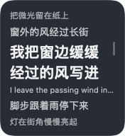
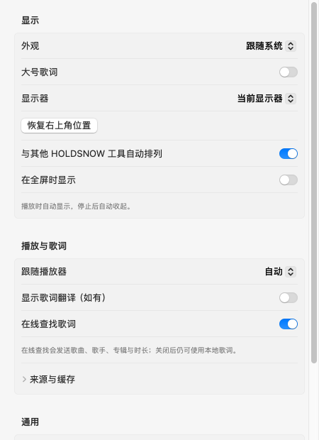

# LyricTile · 2026-11-27 界面收敛复核

运行时代码：[`ca361e9`](https://github.com/haohongfei2001-png/nearpane/commit/ca361e9b8c81f93c790bcb77033203c55f4c0d36)。[原生 CI31](https://github.com/haohongfei2001-png/nearpane/actions/runs/45881886204) 全部通过。机器可读结果、文件哈希与证据边界见 [verification.json](verification.json)。本目录对应最终 **192/104pt** 布局；上一轮 204/112pt 截图保持不变。

## 设计裁决

| 状态 | 最终呈现 |
|---|---|
| 真实歌曲正在播放，歌词可显示 | 192pt 五行歌词；当前句 18–20pt，大字 22pt；近邻 14pt、远邻 12pt |
| 正在播放，歌词查找中或不可用 | 104pt 摘要；真实封面、标题、歌手和简短状态 |
| hover | 同一外框内显示歌曲信息、播放控制与真实进度；歌词态遮住上下文并保留当前句 |
| 暂停 | 默认隐藏；仅保留正在操作的同一歌曲面板，交互结束即隐藏 |
| 无歌曲、停止、缓冲或未知 | 隐藏并撤回独立侧栏注册，保留菜单栏入口 |

当前句根据实际宽度使用一或两完整字形行，外框不随句长跳动；超长句保留原生滚动、真实溢出指示和完整文本提示。统一 18pt 圆角并减轻材质覆盖。紧凑态 hover 保持歌曲信息位置；点击封面返回实际播放器。无封面使用中性符号，缺失歌手留空，未知时间显示 `—:—`。

## 原生截图

| 常态 | hover |
|---|---|
|  |  |
|  |  |
|  |  |

[无歌曲记录](fixture-no-song-transparent.json)的 `maximumAlpha = 0`、`nativeGlyphViews = 0`，没有绘制等待面板。所有图片由生产 `LyricPanelView`、NSHostingView、AppKit 与 CoreText 渲染。测试检查视图边界、真实相邻 cue、短句/长句视口以及缺失字段；人工复核未发现重叠、非预期裁切或 hover 信息跳位。

欢迎页采用实际应用图标和简短介绍；设置直接展示在线查找与自动显隐说明。下方为原生窗口截图，设置其余内容在正常滚动区域内。

| 欢迎 | 设置 |
|---|---|
|  |  |

## 验证结果与范围

- macOS 27.0.1 arm64、Xcode 27.1、Swift 6.4；生产 app 与宿主 facade 编译通过。
- [Swift Testing](test-results-swift-testing.xml) 的 75 个测试定义和 [XCTest](test-results.xml) 的 13 个用例全部通过；原生布局参数化覆盖七个场景。
- ad-hoc 候选包完整性、生产无播放隐藏、欢迎/设置加载和已打包 helper 加载通过。
- 实际无播放器候选空闲采样 120.8 秒、110 点：平均单核 CPU 0.099%，RSS 中位 55.25 MiB、峰值 55.27 MiB，符合既有预算。仅为空闲基线。

布局截图使用只存在于 Tests 的原创输入，没有播放器、生产会话锁或播放命令。控制按钮置灰、中性封面为夹具预期；截图不证明真实封面接收、鼠标事件或播放读回。透明图与生产启动检查分别验证绘制内容和真实窗口隐藏。

## 必要的后续界面确认

新版签名安装包仍需在实际桌面复核播放→暂停→离开→再次播放、真实歌曲封面与进度、歌词到达时切换以及浅/深壁纸下的玻璃观感。与其他工具联排时保留最大 192pt 槽位，因此紧凑态可能留下 88pt 未绘制区域；此策略避免歌词到达时推动其他工具，动态缩槽未纳入本轮。本次没有发布新版本，也未将旧构建的实机长稳结果计为新界面通过。
