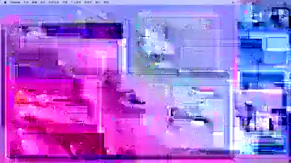

# Nearpane

**A persistent, modular interaction layer for the Mac desktop.**

Nearpane brings real macOS Spaces, windows, and displays together with two first-party always-on capabilities — Saytile voice input and Riftlet screenshot capture — plus user-configurable modules such as an AI assistant, notes, tasks, calendar, clock, and weather.

The goal is to make the desktop itself a visible, actionable workspace: users can understand and switch between real desktop spaces, keep essential tools within reach, and choose which additional capabilities deserve a permanent place in their workflow.

## Product capabilities

- **Desktop orchestration:** Visualize real macOS Spaces and their actual windows, preserving window geometry, proportions, positions, and overlap. Click a Space to switch to it or a visible window to activate it.
- **Saytile voice input:** Keep one continuous, editable, faithfully transcribed text stream within reach.
- **Riftlet screenshot tray:** Capture and stage screenshots, then attach them to the intended draft through Riftlet's existing interaction and recovery model. Capturing or attaching never means automatically sending.
- **Configurable modules:** Let users choose additional always-available tools, including AI assistance, notes, tasks, calendar, clock, weather, and future modules.

Nearpane observes and enhances the native macOS desktop. It does not replace Spaces with a virtual desktop system, and it does not turn the main panel into a conventional Dock or a generic widget dashboard.

## Product documentation

- [Product Definition](docs/PRODUCT_DEFINITION.md) — product positioning, three-layer architecture, core capabilities, configurable modules, principles, and boundaries.
- [Visual Authority](docs/design/NEARPANE-VISUAL-AUTHORITY.md) — the approved side-panel visual direction, default proportions, Space mapping, and real-window geometry rules.

## Approved visual reference

This is the approved overall visual-direction reference. The exact side-rail proportions, module boundaries, Space mapping, window-frame scaling, and interaction/acceptance rules are specified in the [Visual Authority document](docs/design/NEARPANE-VISUAL-AUTHORITY.md). If incidental geometry in the illustrative image differs from the written rules, the written geometry specification takes precedence.

The default visual baseline remains a narrow edge surface (approximately one-eighth of the screen width), without a title, logo, or product-name header. Saytile and Riftlet occupy the upper tool area; the lower area presents real macOS Spaces. User-configurable modules are part of the product architecture, while their detailed placement and overflow behavior require a separate design decision and must not silently compromise the approved baseline.

## Project status

These documents define the intended product. They do not claim that the described capabilities have all been implemented or validated. Product design, engineering implementation, and real-world macOS validation must be tracked separately.
