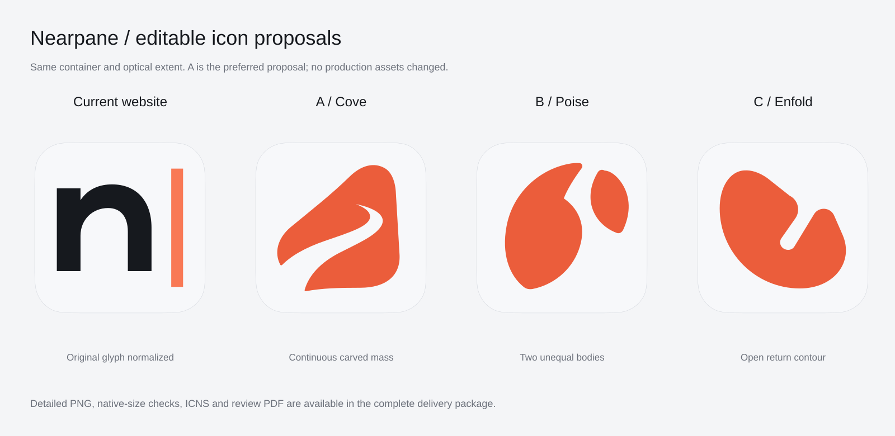

# REJECTED — historical Nearpane icon proposals

The user rejected this round with “非常差”. The prior recommendation of A / Cove is withdrawn. Cove, Poise, and Enfold must not be treated as approved or recommended brand assets. Files remain only as an historical design record. Production website and app icons were not changed.

---

# Nearpane icon proposals - 2026-11-13

Historical status before rejection: unapproved proposals. The preference recorded below is withdrawn.

## Review and files

- [Complete design review](README.zh-CN.md)
- [Independent review](verification/final-independent-review.md)
- [Full PNG / ICNS / iconset / SVG package](https://chatgpt.com/library?file_id=libfile_58354fff35188191884d33021441cd9d&account_id=personal) (owner download)
- [Nine-page review PDF](https://chatgpt.com/library?file_id=libfile_18b7c14391e48191be962a448d77e17e&account_id=personal) (owner download)

This branch preserves editable vector sources, actual optical paths, color values, the rebuild script, and evidence. The complete binary asset package is delivered through the links above. Directory references in the long review describe that complete package.

## Source candidates

- [A Cove](A_Cove/source/mark-color.svg) - rejected
- [B Poise](B_Poise/source/mark-color.svg)
- [C Enfold](C_Enfold/source/mark-color.svg)

Rebuild all macOS assets from `design-config.json` with `python build_assets.py`, Pillow, svgpathtools and Inkscape CLI. No raster image is embedded in the SVG masters.
