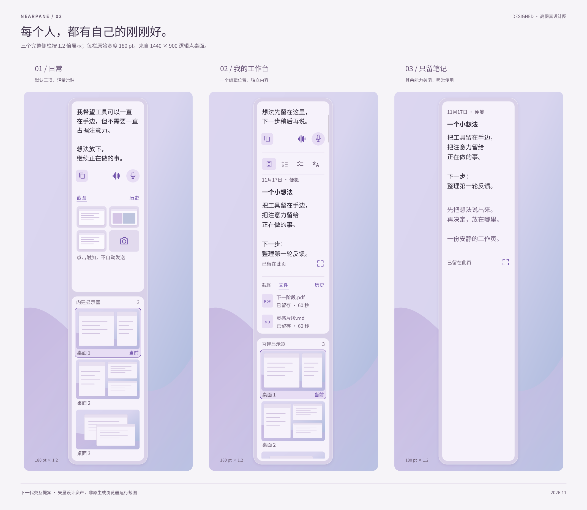
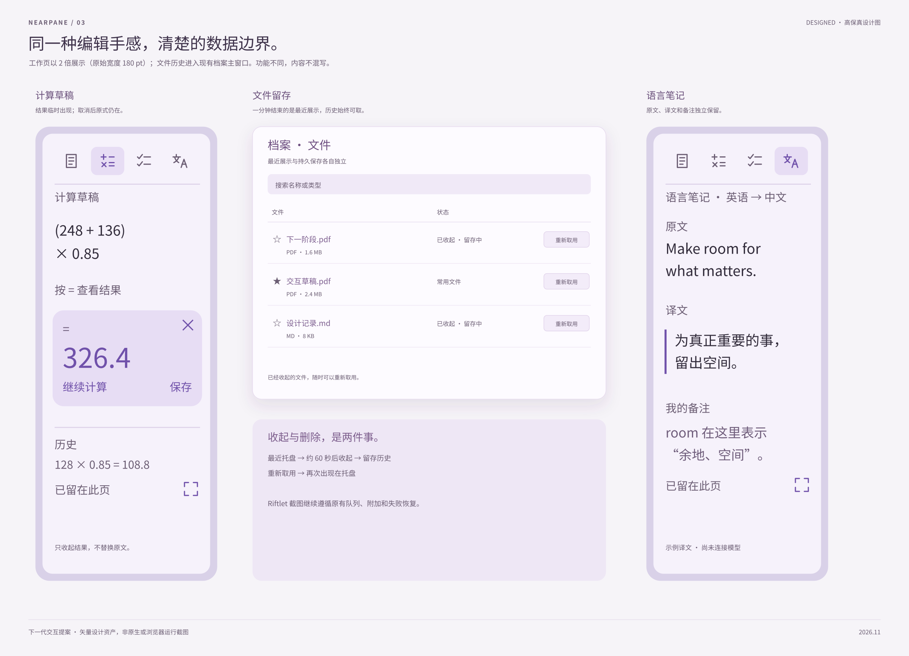

# Nearpane 下一代桌面交互层

**交付日期：2026-11-17 · 状态：Designed / 独立替代提案 · 产品原生实现尚未开始。**

这是一份可交给 Codex 实施的产品设计包。设计目标是让更多能力进入 Nearpane，同时保持窄、稳、轻：上方是可配置的工作表面，下方是稳定的真实空间入口。功能共享视觉与操作方式，各自保存数据。

## 阅读与执行入口

| 文件 | 用途 |
|---|---|
| [产品定义](product-definition.md) | 定位、默认组合、模块体系、产品范围 |
| [布局与交互](layout-interactions.md) | 自动布局、手动调整、不同屏幕、显隐与密度 |
| [模块与数据架构](architecture-data-model.md) | 领域边界、实体字段、跨模块传递、存储与迁移 |
| [各功能规格](module-specifications.md) | 笔记、计算、待办、文件、剪贴板、语言、媒体完整行为 |
| [基线审计](baseline-audit.md) | 最新原生实现、历史规范、未合并 PR、证据边界 |
| [平台可行性](platform-feasibility.md) | 官方 API、第三方接入、权限、替代方案及来源 |
| [替代决策与冲突](decisions-and-conflicts.md) | 修改了什么、保留什么、推荐与替代方案 |
| [开发任务与验收](codex-implementation-plan.md) | 分阶段任务、依赖、完成标准、停止条件、交接 |
| [设计研究](design-research.md) | 成熟产品的可取之处与本方案裁决 |
| [交互原型](prototype/index.html) | 下载后直接用浏览器打开；自包含、无需构建或联网 |
| [视觉与演示说明](prototype/README.md) | 场景、操作、模拟范围、设计资源 |
| [验证记录](verification.md) | 本轮实际检查、设计图与没有验证的事项 |

## 先看这六个决定

1. **用自适应布局取代固定 3/8＋5/8。** 上方独立滚动；下方按可读尺寸、空间数量与用户调整保留稳定预算。内容更新不能反复推移分界线。
2. **统一工作页。** 便笺、计算、待办、语言使用共同编辑外壳与档案入口，分别存储。启用多个模块不等于同时铺出多个完整卡片。
3. **收起不等于停用。** 语音继续采集、文件仍然保存；用户明确关闭模块才停止它的采集和后台活动。
4. **文件保存与临时展示是两件事。** 通用文件成功入库后默认展示 60 秒，之后退出最近托盘，仍在档案中。Riftlet 截图沿用原队列规则。
5. **系统集成按能力开放。** 原焦点插入、系统提醒事项、播放器控制各有独立适配器；没有证据时明确回退。
6. **继承当前原生主线。** 保留 P5.13 统一档案/设置、Saytile/Riftlet 领域锁、持久 WorkRect，以及后续可撤销窗口快照、会话挂起和更新重启保护。设计 PR 不修改现有权威规范、原生代码、官网、工作分支或已安装版本。

## 实际视觉成果

以下为可编辑 SVG 生成的高保真设计稿，**不是原生应用或浏览器运行截图**。默认宽度仍为逻辑屏宽的 1/8；放大画板只用于评审细节。

[完整桌面与 1/8 宽度](prototype/assets/01-desktop-design.png) · [小屏、深色、权限受限与副屏](prototype/assets/04-boundary-states.png) · [自包含 HTML 原型](prototype/index.html) · [原型操作与边界](prototype/README.md)

## 基线与权威

设计分支基于 `main@e3f26bbaa1ba4da87da56b475f5fa6fa5daa8766`，只新增本目录。实际产品研究先审查 `implementation/host-foundation-20261109@1d7fc062b2b7e99ad56721c3fc012e3c48f4f4b0`，交付前已补审新增 9 个提交，最终固定到 `beeccbaa80ea1239042338b48cf5f53011a74c22`。可证的个人安装线仍为 P5.13 Alpha 64；源码新增 P5.14 受限窗口捕获证据不等于新的安装收据。视觉 V2、ADR-010—013 继续作为本设计未明确替代部分的依据。两条仓库线不是同一套内容。

本目录是明确的候选替代设计，**不因进入仓库而自动覆盖旧规范**。实施分支采用本设计时，须按 [冲突表](decisions-and-conflicts.md) 明确记录哪些条款被替代、保留旧文本与用户值；未列为替代的第一方行为继续遵循原契约。不得把旧 PR #7—#9 整支合入以代替基线核对。

## 状态语言

- **Designed**：本设计包明确了目标行为与验收条件。
- **Implemented**：原生产品存在对应代码与提交；原型的 HTML 行为只能标 `Implemented · Web prototype`。
- **Validated**：证据必须带环境、版本、场景与结果。浏览器交互验证不能升级为 macOS 权限、文件持久化、Spaces、上传或第三方集成通过。

视觉原型里的桌面、Spaces、播放器、翻译与系统权限均为合成演示。请同时阅读 [verification.md](verification.md)。
