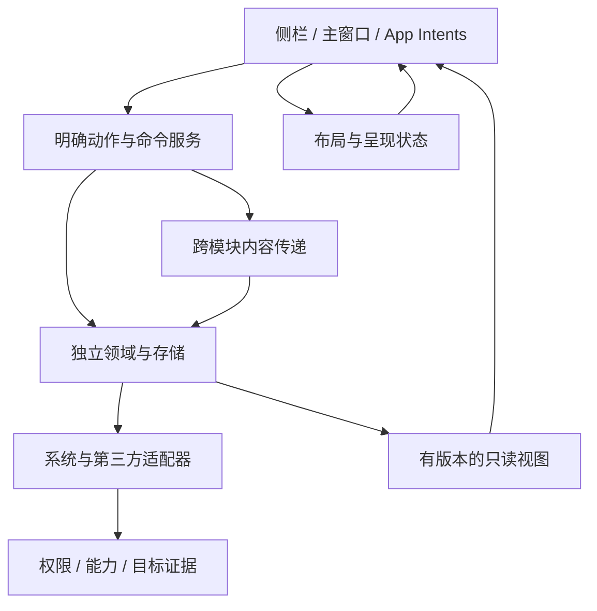

# 03 · 模块架构与数据模型

**范围：设计协议，未新增原生实现。** 采用现有 Swift/SwiftUI/AppKit Host、ModuleRegistry、SnapshotBus 与 P5.12 主窗口，逐步替换固定布局组合。不存在必须重写全部 Nearpane 才能实现本设计的理由。

## 1. 架构边界

这里的 Domains 是多份独立服务，不是一张全产品内容表。语音和截图继续使用既有上游域及锁文件；新领域不得直接写它们的 SQLite、修改捕获生命周期或拿宿主快照总线当无限广播内容的渠道。

| 层 | 责任 | 不承担 |
|---|---|---|
| Host / LayoutEngine | 显示器、表面布局、生命周期、焦点、状态投影 | 重新实现识别器、截图队列、翻译模型 |
| 领域服务 | 文档命令、数据一致性、保存、搜索、恢复 | 操作其它领域数据库 |
| ActionBroker | 一次明确操作的源/目标、数据种类、复制/引用政策 | 默默共享全部历史、自动同步不相关领域 |
| CapabilityService | 权限、系统版本、目标与适配器真实能力 | 用“已授权”推定功能已验证 |
| Provider adapter | EventKit / Translation / Music / 文件观察等 | 将第三方事件当用户指令；隐式开启另一个服务 |

沿用现有实例 ID、revision 和 epoch 拒绝迟到事件。停止/重启一个模块产生新 epoch；旧识别、翻译或下载回调不能覆盖新草稿。可信内置模块首期仍可同进程运行；抛错隔离不等于进程崩溃隔离，远端/高风险服务可后续置于 helper，但本轮不为所有模块建设插件框架。

## 2. 三组正交状态

| 状态组 | 枚举 | 规则 |
|---|---|---|
| Lifecycle | disabled / starting / running / suspended / failed | 关闭停止 observer/timer/network；隐藏不改变 running |
| Presentation | hidden / transient / resident / collapsed / focused | 展开只改变呈现，不启动第二份领域实例 |
| Capability | available / permissionNeeded / denied / unsupported / offline / limited | 每个具体动作独立；读可用不意味着写可用 |

不继续把 expanded、resident、permissionRequired 全塞在单一互斥枚举里。例如语音可以 `running + collapsed + available`，翻译可以 `running + focused + offline`。迁移时兼容当前 `ModuleState`，先建立映射，再消除旧视图中的二义判断。

注册描述增加 `surfaceRole`、可支持的内容类型、最小/偏好尺寸、可用动作、所需权限和档案入口。样例 `*-sample` IDs 不升级伪装成真实数据域；实际 ID 使用独立命名，例如 `com.holdsnow.nearpane.notes`，迁移样例需明确检查它是否只有演示内容。

## 3. 数据实体契约

所有持久实体至少有 UUID、schemaVersion、createdAt/updatedAt（UTC）、revision；显示时间按系统 locale/timezone。更新使用预期 revision，冲突保留双方版本，不最后写入悄悄抹掉旧稿。时间表明记录事实，不替代系统目标身份。

| 领域 / 实体 | 必需字段 | 所有权、生命周期 |
|---|---|---|
| Host / ModulePreference | moduleID, enabled, pinned, order, preferredPresentation | 仅布局与状态；不含模块正文 |
| Host / DisplayLayout | stableDisplayID, edge, panelSize, dockMode, reservedWidth, auto/manual, splitPreference, legacySnapshot | 每屏独立；短暂掉屏不删除偏好；UI显隐不改 WorkRect |
| Notes / NoteDocument | id, title?, blocks/text, revision, attachments[], provenance? | 本地独立便笺；自动保存；删除进入可恢复区 |
| Calculation / CalcSheet | id, rawLines[], locale, engineVersion, precision, references[] | 原始文本永久优先；结果是投影，不覆盖正文 |
| Calculation / Evaluation | id, sheetID, lineID, sourceRevision, expressionSnapshot, resultCanonical, resultDisplay, engineVersion, timestamp | 成功计算历史快照；取消显示不改原式 |
| Tasks / LocalTask | id, title, body?, dueComponents?, timeZone?, completedAt?, sortOrder | 本地任务，无需 EventKit |
| Tasks / ReminderLink | providerType, sourceIdentifier, sourceSnapshot, calendarID, itemIdentifier, externalIdentifier?, localCacheVersion/contentFingerprint, displayCache, pendingDraft?, linkState | 系统记录为权威；本地缓存版本不是EventKit服务端revision；不确定关联不得自动重建 |
| Files / StoredFile | id, originalName, relativeStoragePath, rootID, kind/UTType, byteCount, digest?, ownership, originalSource?, importState | 真实文件字节为对象，目录引用与显示记录分开 |
| Files / ShelfEntry | id, fileID or ScreenshotRef, lane, shownAt, visibleUntil?, pinned, lastUsedAt, displayState | 仅控制展示；通用文件TTL默认60秒，ScreenshotRef不由该TTL控制 |
| Files / StorageRoot | id, bookmark, resolvedURL, lastVerifiedVolumeID, availability, generation | bookmark是访问凭据而非文件备份；离线不删根或子记录 |
| Clipboard / Clip | id, changeCount, type, contentHandle, observedAppHint?, originConfidence, capturedAt, expiry, sensitivity | 来源可信度与敏感性分别记录；默认仅RAM当前会话，历史另行启用并加密正文 |
| Language / LanguageNote | id, original, translated, sourceLanguage, targetLanguage, annotations, providerID, modelVersion?, sourceURL?, sourceRef?, revision | 与Notes/语音独立；翻译任务成功不自动创建笔记 |
| Language / TranslationJob | id, requestRevision, exactInput, provider, languages, status, output? | 当前稿任务；新请求到达使旧回调过期；失败保留原文 |
| Media / PlaybackSnapshot | provider, sessionID, kind, title, creator, position?, duration?, state, capabilities, lyricsRef?, chapter? | 短期缓存，过期就标未知；不冒充持久音乐资料库 |
| Media / ListeningNote | id, sourceURI, episodeTitle, position?, note, provenance | 用户明确保存的时间点笔记；缺少进度则不伪造时间戳 |
| Target / InputTargetLease | processID+launchIdentity, windowID/AX, elementRef, documentIdentity, selectionFingerprint, gestureID, expiresAt | 仅内存、短寿命；不写文件、不作为跨会话自动输入授权 |
| Broker / TransferReceipt | id, gestureID, sourceDomain/ref/revision, destinationDomain, operation, state, destinationRef?, failureCode? | 元数据审计不存全文；重试通过幂等键避免重复 |

`ownership` 取 `managedCopy / managedMove / externalReference / screenshotReference`。前三者不能混用“已保存”：externalReference 只表示可访问引用；ScreenshotRef 的生命周期仍归 Riftlet。FileStore 不在用户清理通用文件时删除截图原件。

## 4. 存储与恢复

新领域分别使用独立目录/数据库（具体产品容器根复用现有 Host 路径解析，不自行改 bundleID）。示意：`Domains/Notes`、`Calculations`、`Tasks`、`Files`、`Language`、`Clipboard`。采用各自 schema 与迁移日志，不改变现有 Saytile/Riftlet 的数据库版本和共享锁。

笔记/计算/语言编辑使用本地 journal：输入短间隔提交，失焦/切页/收起/停止前 flush；后台写入失败保持脏稿可见并可导出。IME 组合期间不重绘整份编辑器、不重置选区。切换模块只切换活跃记录引用，不将同一 textBuffer 改类型。

文件导入为 `received → materializing → verifying → committed → visible → archived`；展示可固定/过期，存储只在明确删除时进入 trash。断点恢复检查 journal 与实际文件，不根据一条“成功”日志假定已经完整入库。可选managedMove在源清理前再次核验原file identity与内容指纹；目录/包使用完整清单与变化检测。源已变更或无法确定时保留源和副本，显示“已保存副本，原文件保留”。源清理是可恢复、可重入的事务，保存原位置和恢复凭据，不用无条件unlink。

目录迁移为可恢复事务：冻结新根提交 → 复制/校验 → 更新根与引用 → 恢复写入；保留旧根直到验证完成，旧副本清理由单独明确操作处理。**稳定下载收件目录与可迁移对象库分离**：浏览器继续写稳定Inbox，对象库迁移不改其路径，未完成下载保留在原处；默认完成后复制一次入库，可选明确移入。已位于对象库的文件只建立/更新索引，不再次复制。迁移中收到的已完成下载进入待导入日志，切换后继续处理。

默认没有账号或新云同步。系统提醒事项由用户自己的系统账户同步；这不表示 Nearpane 便笺/文件/录音随之同步。导出使用用户指定目录，文件索引不应因复制到云盘而自动获得多设备数据库同步能力。

用户清理剪贴板历史须移除密文及索引并处理 WAL/缓存；密钥由 Keychain 保存。普通模块数据使用私有目录权限，不宣称单纯 SQLite 等于应用级加密。日志、崩溃与测试附件默认只记录匿名标识/状态，不记笔记正文、剪贴板、文件字节、歌词或录音。

## 5. 跨模块传递协议

一次 `ContentTransfer` 包含：源领域/记录/revision、选区或选定文件、用户动作、目标领域/操作、明确 payload 类型、权限上下文、幂等 ID。无全局“自动处理所有内容”订阅。

| 动作 | 默认语义 | 删除/失败行为 |
|---|---|---|
| 语音选区 → 便笺 | 复制选定文本，附来源记录引用 | 原语音不变；源删除后便笺文本仍在 |
| 便笺 → 待办 | 从当前选区创建一条，选区为空则使用明确当前段落 | 创建失败留草稿；不能为了重试多生成系统任务 |
| 文本 → 翻译 | 临时传递明确选区 | 不保存语言笔记；云端前按所选provider授权 |
| 翻译 → 语言笔记 | 保存原文、译文和备注的独立记录 | 普通便笺与源语音不被改写 |
| 文件 → 便笺 | 默认引用已保存FileID；选择导出时复制字节 | 文件被删除显示失效附件，不连带删整篇便笺 |
| 截图 → 通用文件 | 用户明确“另存至文件中心”才创建受管理副本 | Riftlet原截图队列和历史不变 |
| 剪贴板 → 原输入框 | 进入TargetLease和动作准入 | 不保存笔记；失败明确复制，未确认不自动重试 |
| 播客 → 笔记 | 明确保存节目与可靠时间点 | 无进度时保存来源，时间字段空值 |

`TransferReceipt` 的成功只证明目标域提交，不证明网络上传、第三方输入或系统同步成功。外部动作另有 `prepared / dispatched / confirmed / unconfirmed / failed / cancelled`，回执必须反映实际证据。

提醒事项外部ID可能返回多个候选、本地ID可能在全量同步后失效；通过来源/列表与已有快照核对，不能仅按标题日期重绑定。无匹配/多匹配进入unresolvedLink，保留草稿与只读缓存，停止自动更新和新建。写前重取减少并发风险但不构成系统级CAS或跨库原子事务。[平台审查 S26–S28]

App Intents不假设存在已验证的稳定系统execution ID。每个应用命令先持久化自己的command UUID和outbox，内部重试复用它；独立Siri新调用按新请求处理，不按相同文字/短时间窗口去重。外部保存已分发而本地回执未落盘的崩溃恢复进入uncertain，先核对系统记录，不能盲重建。没有可靠关联标记时不承诺跨崩溃严格exactly-once。

## 6. 原输入框服务的复用范围

从现有 `NearpaneManualInsertion` 抽取目标识别与证据验证，保留 Saytile 动作策略；新增 ClipInsert/TranslationInsert 调用共同低层服务，但不能为它们便利而放开 Saytile 现有禁止盲粘贴的约束。

复制来源与插入目的分别记录。侧栏的非激活点击在手势开始前冻结最近已确认的外部编辑目标；进入 Nearpane 详细编辑器则使旧租约受时效与身份检查约束。每次插入前检查进程启动身份、窗口、元素、网页文档、选区/内容版本、权限、非安全字段和可写selectedText。只重激活仍经验证的同一目标；不能靠“最近使用的App”猜输入框。

目标不可读、网页换页、进程重启、IME组合、密码字段或只支持全字段替换时降级为显式复制。一次写入结果不明则标未确认，不自动重试。剪贴板回退是用户点击“复制”的新动作，不是假装精准插入完成。

## 7. 兼容和迁移清单

- 读取并记录当前域锁（本轮基线 Saytile `012999c…`、Riftlet `189782d…`）；更新上游必须作为独立变更审查，不从旧PR覆盖。
- 新布局元数据采用具备版本和兼容策略的附属配置，不向旧DisplayMetric枚举字典直接写入未知项，不无方案提高旧HostConfiguration严格schemaVersion。保留完整legacySnapshot及逐屏恢复。旧measures缺键才表示默认，glass=nil表示跟随；显式保存相同默认数值仍须保留。
- 旧 ModuleRegistry 映射为新正交状态后验证 late-event 丢弃；对已关闭模块不得重开 observer。
- 主窗口导航引用同一现存记录；不能再做第二份截图档案或语音时间线。
- Native/Virtual、WorkRect与真实窗口写入能力的门槛继续由桌面域负责；通用文件和笔记不依赖私有Spaces读取。
- 所有新领域本地可独立打开；单一provider缺失不把Host置为全局不可用。

配置回归必须覆盖：空measures/glass=nil；显式voiceHeight=22.5%；panelWidth=20pt且reservedWidth=119pt；另一显示器左边缘/Floating/主动隐藏；新→旧→新往返。旧模块表过滤未知ID后，新附属配置和独立领域数据仍完整，新模块顺序、草稿与旧值不可被静默丢弃。
