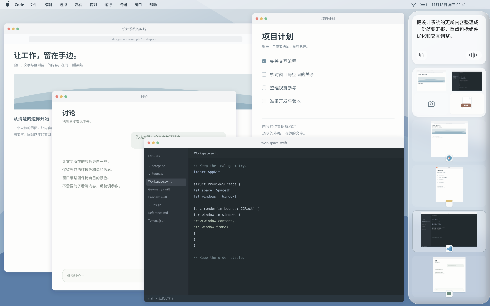

# Nearpane · R4 视觉设计与实施参考

2026-11-18（北京时间） · **Designed / 设计交付完成，原生光学校准待完成**

本包是此次 Nearpane 外观设计的当前入口。R4 延续无标题的窄纵向白色玻璃侧栏，在 R3 上完成表面层次、窗口密度、真实使用构图及关键交互状态的细化。它用于指导原生实现与对照验收；不表示用户已逐项批准参数，也不将静态图当作原生产品完成的证明。

## 先看这三项

1. [完整 R4 设计图册](Nearpane_Visual_Reference_R4.pdf)：实际占屏比例、两/三工具、玻璃、托盘与交互状态。
2. [SPEC.md](SPEC.md)：当前视觉规则、精确替代范围和原生验收标准。
3. [HANDOFF.md](HANDOFF.md)：交给 Codex 的实施顺序与证据要求。

本轮已经收尾：三处末次精修已同步到生成源、SVG、PNG 和 18 页图册；旧视觉权威入口已指向 R4。完整交付与后续衔接见 [RECOVERY.md](RECOVERY.md)。无需再次开始一轮设计恢复。



R3 对应历史提交 [`4521fb7`](https://github.com/haohongfei2001-png/nearpane/tree/4521fb7e3118ff2caea6016823c8af292fe49039/docs/design/visual-reference-20261118)。该版本保留在 Git 历史供对照；当前实现使用 R4，不混用两版图稿或参数。[REVIEW-CHANGES.md](REVIEW-CHANGES.md)解释本轮保留和调整的理由。

## 已完成的设计裁决

| 项目 | R4 参考 |
| --- | --- |
| 默认宽度 | 保留受可读性约束的宽度公式；1440 pt 屏宽使用 240 pt；常用调整区间约 12.5%–25% |
| 浅色玻璃 | 外壳白色覆盖率 0.58，内容底板 0.88；环境色留在外沿，文字底板更稳定 |
| 深色玻璃 | 独立深色参数：外壳 `#24272B` / 0.72，内容 `#202226` / 0.94 |
| 前景 | 文字、图标及窗口图像 alpha 为 1；玻璃调节只改变背景 |
| 边界 | 外壳圆角 28 pt，工具内卡 16 pt，内距 12 pt；参考 2× 输出的细边为 0.5 pt，选中轮廓为 0.75 pt |
| 工具占位 | 按实际状态和高度计算；窗口列表紧接最后一个工具，使用全部剩余高度 |
| 窗口密度 | 独立窗口按源图比例 Fit，预览槽最大高度为可用图宽的 0.50 倍；徽标尾部 18 pt，行间距 11 pt |
| 组合与 Space | 共用真实 WorkRect 坐标变换；全屏与 Split View 使用完整显示器边界；不从相邻或平铺推断成组 |
| 新功能 | 统一截图/文件托盘；备忘内计算；原词附近翻译；待办为可选工具 |

覆盖率是参考渲染器的光学参数，不是原生设置中的透明度滑杆值。原生需按同一背景与内容校准。较密的独立窗口预览换来更多可见对象，也会减小高窄窗口的画面；它不是“所有状态必须同时显示四窗”的承诺，用户可继续在现有独立设置中调整行密度。

## 图稿索引

| 图稿 | 用途 |
| --- | --- |
| [00 自然工作场景](assets/00-lived-desktop.png) | 不同比例与自然重叠的窗口，检视侧栏在实际工作构图中的关系 |
| [01 四窗默认桌面](assets/01-default-desktop.png) | 1440×900 pt、240 pt 侧栏、两工具与四个独立窗口 |
| [02 布局对照](assets/02-layout-comparison.png) | 两工具、三工具、明确暂停、双窗组合 |
| [03 宽度对照](assets/03-width-comparison.png) | 同一内容、同一托盘高度的 180 / 240 / 360 pt 对照 |
| [04 材质对照](assets/04-material-comparison.png) | 同背景和内容的清透、标准、清晰与独立深色材质 |
| [05 对象状态](assets/05-state-reference.png) | 独立窗口、组合、高窄窗口、其他桌面、无画面与可选工具 |
| [06 标注细节](assets/06-annotated-detail.png) | 主要尺寸和表面关系；不用于判断默认占屏宽度 |
| [07 三工具桌面](assets/07-three-tools-desktop.png) | 第三个工具实际占位，调度列表继续向下接续 |
| [08 双窗与 Spaces](assets/08-split-workspace-desktop.png) | 明确组合与其他真实 Space 的连续列表 |
| [09 原生与辅助显示](assets/09-native-and-accessibility.png) | 原生全屏、Split View、空态与降低透明度 |
| [10 托盘流转](assets/10-tray-flow.png) | 空入口、截图进入、文件进入和容量变化 |
| [11 语音与备忘](assets/11-voice-and-memo.png) | 连续正文、暂停及备忘内计算等工具状态 |
| [12 原处翻译](assets/12-inline-translation.png) | 原词附近的临时结果及独立单词本语义 |
| [13 交互状态](assets/13-interaction-states.png) | 悬停、选中、焦点等反馈与稳定命中区域 |
| [14 背景压力对照](assets/14-background-stress.png) | 浅、深及复杂背景中的文字底板与图像保真 |
| [15 密度对照](assets/15-density-comparison.png) | 同宽、同源内容的 R3 / R4 窗口密度与辨识度取舍 |

图稿为确定性设计场景，不是用户桌面截图。桌面与缩略图复用同一组不可变窗口源及其几何；所有正式 PNG 均有同名 SVG。

## 生成与单一视觉源

`render_reference.py`、补充图稿生成源与 `design-tokens.json` 共同定义场景和参数，生成 SVG 与几何记录；`render_svg.cjs` 输出 2× PNG，`build_design_book.py` 组合 R4 图册。按生成源的当前入口运行，不直接修改导出 PNG 或 SVG。

```bash
python3 render_reference.py
node render_svg.cjs
python3 build_design_book.py
python3 validate_reference.py --pdf
```

依赖为 Python 3、Node.js、`sharp`、`reportlab`、`Pillow`、`pypdf` 和 Noto Sans CJK SC 字体。预装运行环境可通过 `CODEX_PRIMARY_RUNTIME_NODE_MODULES` 定位 `sharp`；普通环境安装同名依赖。图册原图对照可通过 `NEARPANE_ORIGINAL_REFERENCE` 指定仓库原始参考图。

## 已有原生能力与本轮边界

本轮设计已同步原生基线 `c5e05334bd45784aa4d1ecf5329028ad6e9d66ff`。该基线的 5.20 记录了同桌面窗口卡、受权原生面板四窗画面，以及隔离最终安装实例的跨应用双窗自动平铺和恢复。不能把这些已完成工作重写为未开始，也不能据此推断跨 Space 切换和迁窗已经通过。详见[5.20 基线状态](https://github.com/haohongfei2001-png/nearpane/blob/c5e05334bd45784aa4d1ecf5329028ad6e9d66ff/engineering/native-spaces/STATUS.md)与[5.20 验收记录](https://github.com/haohongfei2001-png/nearpane/blob/c5e05334bd45784aa4d1ecf5329028ad6e9d66ff/engineering/verification/P5.20-DESKTOP-OVERVIEW-AND-AUTO-TILING.md)；最新专项进度另见[原生 Spaces PR #14](https://github.com/haohongfei2001-png/nearpane/pull/14)。这些固定提交链接保留原生证据的实际版本，不读取本设计分支中较旧的状态副本。

[VALIDATION.md](VALIDATION.md)记录本包最终静态与排版检查。本轮没有修改原生业务代码，也没有运行 R4 AppKit 光学校准或替代已有原生验收。设计、代码实现、真实验证分别记录。

**文件空入口的点击用途仍明确延期。** 其位置与视觉已经定义，不能擅自补成文件选择器、Finder、上传器或云盘；这不阻塞其余已明确外观的实施。
