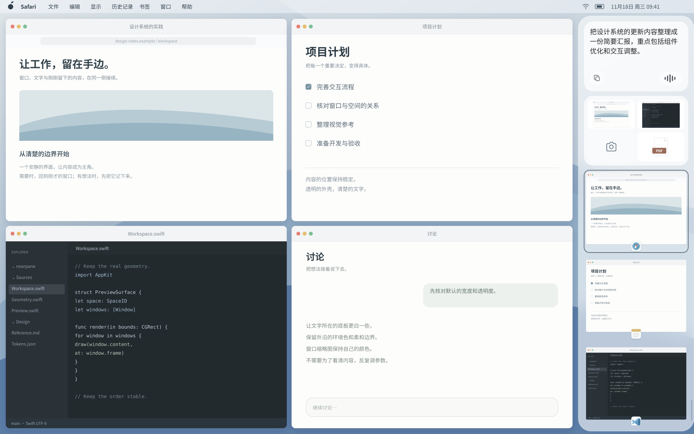

# Nearpane — R3 视觉基准提案

2026-11-18 · **Designed / 原生实现与光学校准待完成**

本包保留原始设计的无标题纵向白色玻璃侧栏，补齐默认宽度、透明底板、工具组合、窗口次序与真实 Spaces 的视觉规则。它是一套可以复现、测量、逐状态对照的设计提案，不代表用户已逐项批准或原生程序已经实现。

## 先看什么

1. [完整设计图册](Nearpane_Visual_Reference_R3.pdf)：默认母稿、原图对照、关键状态和参数摘要。
2. [SPEC.md](SPEC.md)：对象定义、布局规则、更新依据、保留约束、原生验收与实施入口。
3. [design-tokens.json](design-tokens.json)：默认宽公式、尺寸、材质与前景参数。



## 核心决定

| 项目 | 本轮方案 |
| --- | --- |
| 默认宽度 | 常见横屏约16%，受可读性点数上下限及12.5%–25%区间约束；1440pt屏宽默认240pt |
| 玻璃 | 外壳保留环境透色，文字底板更白；默认参考覆盖率0.58 / 0.88 |
| 前景 | 正文、图标和窗口画面alpha恒为1；透明度只影响背景 |
| 工具 | 实际高度优先占位；两/三个工具均完整显示，调度列表紧接其后 |
| 预览 | 单列、顶部对齐、稳定打开顺序；关窗后补位；超出视口滚动 |
| 对象 | 当前独立窗口与明确组合混排，其他真实Space随后；不凭同桌面自动合组 |
| 比例 | 独立窗按源窗口比例；普通组合按WorkRect；原生全屏/分屏按完整显示器 |
| 新功能 | 统一截图/文件托盘；备忘内计算；翻译在原词附近；待办可选 |

材质数值是SVG渲染器中的遮蔽覆盖率，不是旧版原生设置中三个透明度滑杆的值。真实AppKit材质应按同一壁纸和窗口内容对照校准。

## 图稿索引

| 图稿 | 用途 |
| --- | --- |
| [01 默认桌面](assets/01-default-desktop.png) | 判断真实占屏比例；四个独立窗口与两个工具 |
| [02 布局对照](assets/02-layout-comparison.png) | 两工具、三工具、主动暂停、明确双窗组合 |
| [03 宽度对照](assets/03-width-comparison.png) | 同一1440pt屏幕上的180 / 240 / 360pt侧栏 |
| [04 材质对照](assets/04-material-comparison.png) | 完全相同背景与内容上的清透、标准、清晰、深色 |
| [05 状态参考](assets/05-state-reference.png) | 窗口、组合、不对称、高窄、其他桌面、预览不可用及工具状态 |
| [06 标注细节](assets/06-annotated-detail.png) | 放大查看工具与预览关系；不用于判断默认宽度 |
| [07 三工具桌面](assets/07-three-tools-desktop.png) | 1440×900场景里第三个工具的实际占位 |
| [08 双窗与Spaces](assets/08-split-workspace-desktop.png) | 普通明确组合与其他真实Space的连续列表 |
| [09 原生与辅助显示](assets/09-native-and-accessibility.png) | 原生Split View、空态、降低透明度 |

每张PNG都有同名SVG。正文与控件来自确定性的矢量场景，不使用生成式效果图；窗口内容为设计样本，不是用户桌面的实拍。

## 单一视觉源与生成

`render_reference.py`读取`design-tokens.json`，输出9张SVG与`render-measurements.json`。`render_svg.cjs`将它们输出为2倍PNG，`build_design_book.py`组合图册与独立参数说明。

```bash
python3 render_reference.py
node render_svg.cjs
python3 build_design_book.py
```

依赖：Python 3、Node.js与`sharp`、Python的`reportlab`与`Pillow`，以及Noto Sans CJK SC字体。运行环境可用`CODEX_PRIMARY_RUNTIME_NODE_MODULES`定位预装的`sharp`；普通环境直接安装`sharp`即可。PDF原图对照优先读取同仓库历史原图，独立使用本包时可通过`NEARPANE_ORIGINAL_REFERENCE`传入其路径。

材质、主要尺寸与正文参数由tokens驱动；具体示例内容、窗口外观及图外排版由renderer定义。SVG是便于检查的矢量输出，修改时应回到源文件，不手工修补导出图形成第二套规则。

## 依据与验证范围

- 原生基线：`implementation/host-foundation-20261109`，提交`71dd29dbba0fa55249f1af46fc901df65af33c71`。
- 官网基线：`main`，提交`e3f26bbaa1ba4da87da56b475f5fa6fa5daa8766`。
- 近期产品纠正：`design/next-generation-20261117`的Revision 02，提交`c295a4dd49cd9edce6fa97d591987604ef84e6aa`。被否定的Revision 01不再作为依据。
- 原始外观：`design/assets/2026-11-15-v2/interface-reference-original.png`。完整来源链接见SPEC末尾。

[VALIDATION.md](VALIDATION.md)记录本包静态出图与排版检查。窗口出生顺序、真实Space库存、点击聚焦、窗口迁移和AppKit玻璃在真实Mac上的效果均仍需原生验收，不能由静态图证明。

## 实施入口

先按SPEC统一默认宽度、工具高度、背景/前景分层与预览比例，再接真实对象库存和稳定序列。保留原生基线中的5.19前景分层修复；不在旧的96pt图片高度上限与固定3/8工具分区上继续叠加补丁。文件空入口用途仍未定义，禁止擅自补成文件选择器等新功能。

本包为独立设计变更，不包含原生业务代码改动。
