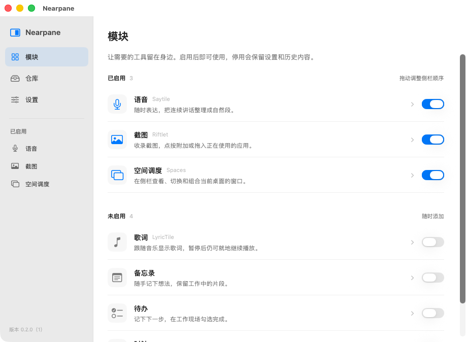
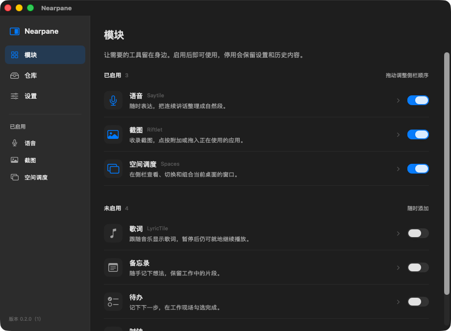
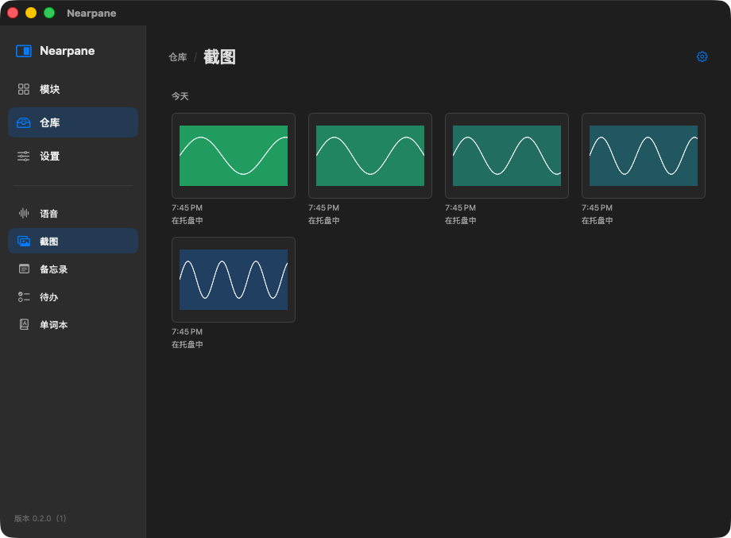
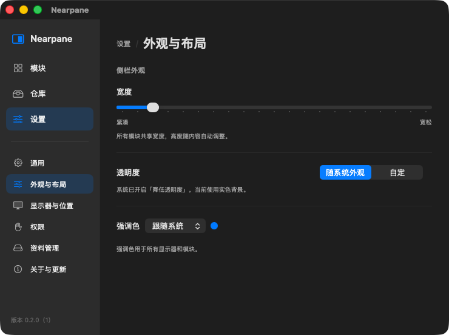
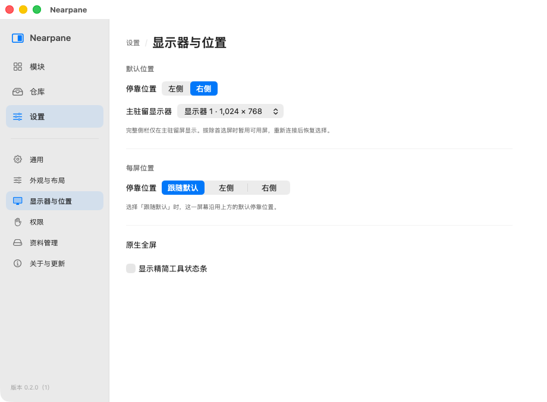
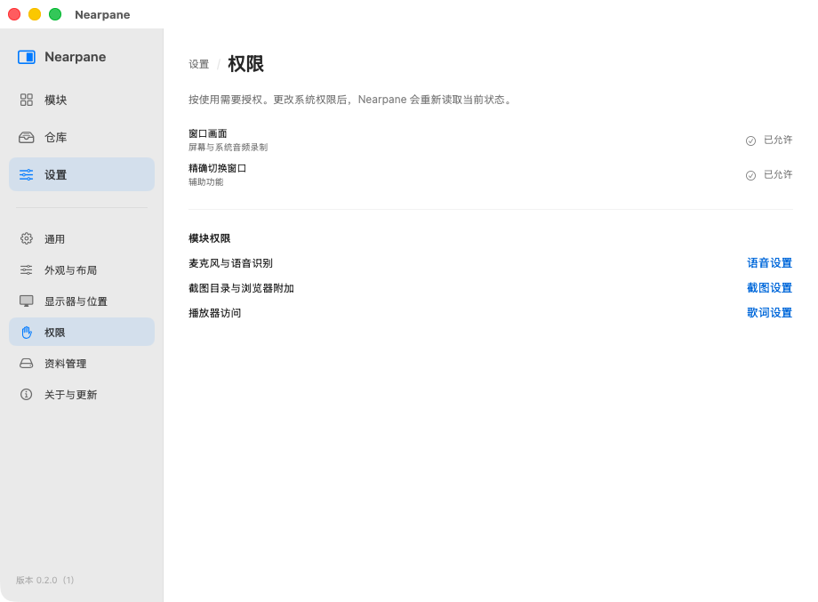
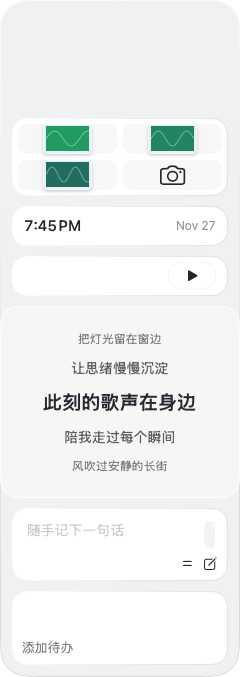

# Nearpane 统一工作台：最终候选与原生验收

本目录保存 **`8c88457332cf55633d071b2992932a1971ded321`** 的实际证据。代码与后续证据提交分开标识；本目录不把源码测试、真实界面操作、播放器验证和正式发行资格合并成一个“通过”。

[产品设计与实现地图](../../../design/2026-11-28-unified-workbench.md) · [完整验收过程](../../2026-11-28-unified-workbench.md) · [macOS CI](https://github.com/haohongfei2001-png/nearpane/actions/runs/46058153742) · [候选下载](https://github.com/haohongfei2001-png/nearpane/actions/runs/46058153742/artifacts/15226944433) · [完整 CI 证据](https://github.com/haohongfei2001-png/nearpane/actions/runs/46058153742/artifacts/15227981724)

## 结果

| 层级 | 结果 | 能够证明的内容 |
| --- | --- | --- |
| 完整源码测试 | **986 项 / 158 个套件，全部通过** | 当前集成代码的回归套件。 |
| 原生构建、打包与资源检查 | **通过，50 个资源** | 完整候选可构建，实际二进制与 UI 验收输入一致。 |
| 原生工作台交互 | **53 / 53 通过** | 六项原生 AX 操作、生产菜单与模块回调、唯一主窗口及关闭重开、组合布局、配置与样例历史保留。 |
| 程序化导航回退 | **0** | 本轮未用内部路由代替失败的界面操作。 |
| 真实界面截图 | **30 张，全部 WindowServer 抓取** | 实际 AppKit / SwiftUI 界面，PNG 与原始 receipt 的 SHA-256 全部一致。 |
| 暂停歌词呈现 | **样例会话范围内通过** | 暂停后持续存在、真实鼠标悬停显示控件；夹具无真实播放器 lease，播放按钮按设计保持禁用。 |
| 真实 Apple Music | **BLOCKED** | 被系统 Automation 授权和首次欢迎页阻塞，未完成真实播放、暂停、恢复及有效会话退出验收。 |
| 正式发行 | **未达成** | 当前是 arm64 / macOS 26+ 的 debug 集成候选，没有完整 Developer ID 发行签名及公证。 |

准确计数、输入类型、候选身份和限制见 [verification-summary.json](verification-summary.json)。原生细项见 [native-workbench-receipt.json](native/native-workbench-receipt.json)，完整测试输出见 [source-tests.txt](source-tests.txt)，CI 各步骤见 [ci-run-metadata.json](ci-run-metadata.json)。

## 实际界面

以下为原始 PNG，未经重绘、裁剪或美化。内容使用明确隔离的验收样例，不是用户历史数据。云端系统开启了**降低透明度**：本组图验证真实布局、浅深色、紧凑尺寸和实色材质回退；不作为默认玻璃模糊效果已验收的证明。

### 模块管理：浅色与深色

### 仓库、设置与统一权限入口

### 侧栏组合与暂停悬停

所有截图及其尺寸、WindowServer 窗口号、抓取方式和哈希均列在原始原生 receipt 的 `screenshots` 字段中，文件位于 [native](native)。

## 候选包身份

- 源码：`8c88457332cf55633d071b2992932a1971ded321`，构建记录为 clean。
- 版本：`0.2.0 (1)`；bundle ID：`com.holdsnow.nearpane.host`。
- **arm64 / macOS 26.0 及以上**，由实际 Info.plist 和 Mach-O 确认；SDK 26.5。
- 下载 artifact 内的候选 ZIP 为 **34,675,081 bytes**。
- ZIP SHA-256：`0d21dd5127cb2855b87a38aca99f82abd52082d52d9e370867fa7aa7480557e1`。
- Host 二进制 SHA-256：`34816cf4c116a1e7f85c09bf48669e25ceed32068a7dec7140ce9ca384415101`。
- Host 可执行文件为 ad-hoc；主 bundle 没有完整发行签名封装。不是已公证安装版。

[candidate-inspection.json](candidate-inspection.json) 保留实际压缩包、plist、Mach-O 检查结果。[package-verification.txt](package-verification.txt) 与 [runner-receipt.json](runner-receipt.json) 共同核对输入身份。UI 运行的是隔离身份、重新签名的副本，副本哈希单独记录；下载候选未被修改。没有替换用户日常安装。

## 证据不能外推的范围

1. **真实播放器。** [系统阻塞截图](real-player/music-setup-desktop.png) 实际显示 `hosted-compute-agent` 请求控制 Music，背后是 Music 欢迎页；没有点击授权。30 秒超时后清理了本次启动的 Music。清理退出不算有效播放会话退出验收。QQ 音乐、网易云音乐及多播放器切换同样没有真实系统验收。
2. **拖拽与数据迁移。** 排序验证调用生产拖放使用的持久化命令并检查结果，没有冒充物理指针拖动。历史保留验证使用隔离样例，不覆盖所有历史版本数据库。
3. **Spaces、全屏和多屏。** 本轮未执行真实窗口调度、原生全屏进出、多屏调度与恢复。副屏权限路由经过静态所有权核查；原生页验收发生在单屏。PR #16 既有调度问题和工程成果仍独立归属。
4. **新增宪章范围。** 上／下边缘与横向布局、真正的模块包下载删除、独立于 Spaces 的完整默认避让仍未实现。当前提供左／右纵向布局及随应用内置模块的启停与管理。
5. **发行。** 当前构建和原生 UI 结果不替代真实麦克风／浏览器权限、安装更新循环、发行签名、公证和发布资格。

## 文件完整性

[SHA256SUMS](SHA256SUMS) 覆盖此目录中的证据与说明文件（清单自身除外）。原始截图还可用原生 receipt 内的独立哈希逐一核对。结构化汇总只归纳原始记录，不改写原始检查结果。
