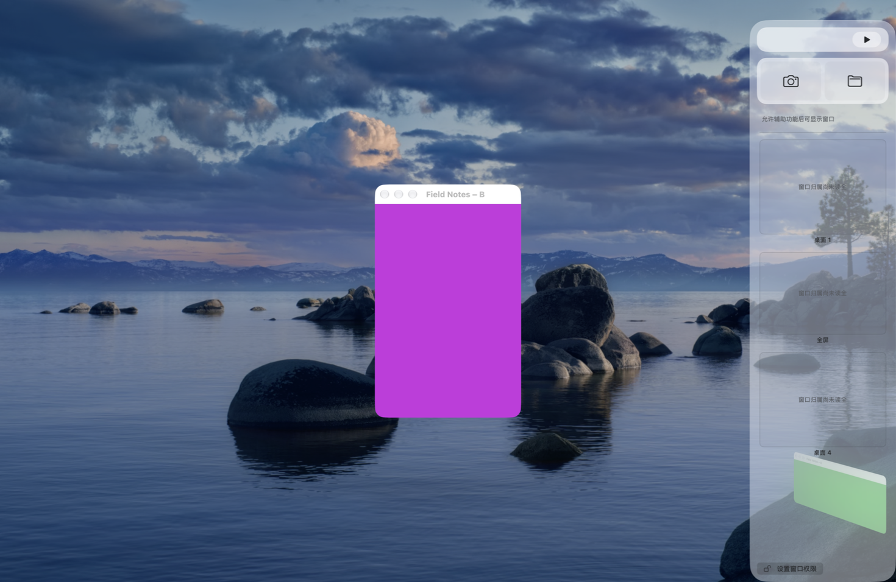

# Nearpane 5.22（90）原生 R4 安装候选

2026-11-20。`/Applications/Nearpane.app` 已安装，源码 `374ab3769d0e2a124eefddedb7f99fc1d55e9c48`。Native Spaces 仍为部分通过。正式侧栏读对了 4/4 个真实 Space 及当前高亮。精确键盘聚焦、系统 Space 切换、跨 Space 迁窗均为 **0 次实机确认**。[实现 PR #15](https://github.com/haohongfei2001-png/nearpane/pull/15) · [签名候选 ZIP](https://github.com/haohongfei2001-png/nearpane/releases/tag/untagged-574a3797a3cfb0b3be40) · [安装与动作收据](verification.json)

画面来自 WindowServer，同屏显示真实系统壁纸、两扇自建文档窗及已安装的 Nearpane。紫色为当前呈现的文档，绿色为系统台前调度呈现的另一扇测试窗。侧栏保留了真实权限提示。截屏仅纳入登记的窗口与系统桌面层。

## 系统调度

本版建立在开放原生 PR #14 的 `629524b` 上，保留了原生窗口管理、语音、截图、用户配置和候选签名修复。R4 取自 PR #13 的 `fa7a0bf`。同屏窗口绑定进程代际、窗口号和观测生命周期。选择请求过期时取消后续聚焦，迁移后独立确认新归属再启动平铺。当前对象、用户显式组合和其他系统 Space 共享一条滚动清单，普通组合使用 WorkRect，全屏使用显示器边界。[原生基线](https://github.com/haohongfei2001-png/nearpane/pull/14) · [R4 交接](https://github.com/haohongfei2001-png/nearpane/blob/fa7a0bf34e292db8d1e017056af795c1598725eb/docs/design/visual-reference-20261118/HANDOFF.md)

| 最终安装版场景 | 实际结果 |
| --- | --- |
| 拓扑与当前 Space | 单屏 1470 × 956 pt、2×，macOS 27.0（26A428）arm64，SIP 和台前调度开启，独立 Spaces 关闭。3 个普通桌面、1 个全屏 Space，4 个身份和当前项与系统独立读回一致。 |
| 普通单窗、同应用双窗 | 正式侧栏没有出现可唯一比对的可点击卡片。0 次正式点击，0 次焦点确认，0 个键盘标记。两批测试均清理窗口，并恢复原桌面和键盘窗口。 |
| 实际切换及迁移 | 产品 Host 报告辅助功能、事件投递、屏幕录制均未获准。助手已就绪，`canSwitch` 与 `canMove` 均为 `false`。本批没有新建且可核验归属的三处测试 Space。系统切换和迁窗均未发出。 |
| 逐窗预览和组合 | 独立看到 540 × 213、240 × 383 pt 的两扇真实窗口。正式侧栏可确认的对应卡片为 0，未取得正式像素、组合和点击成员的实证。本版有权限的隔离控制器在两次因前台变化中止后，改由 Launch Services 后台启动受控应用。随后 4/4 个窗口的像素与来源逐一匹配，关闭与撤下后剩余 2 个，前台保持、夹具全部退出。该项仅计隔离预览。[隔离四窗实拍](screens/isolated-four-window.png) · [撤下后两窗](screens/isolated-two-window.png) · [89 的隔离焦点恢复失败](../5.22-89-r4/RESULTS.md) |
| 性能、兼容性与系统边界 | 隐藏 60 秒新增捕获请求 0。当批结束时未恢复侧栏可见性，随后通过正式状态菜单恢复，重新读到 1 个可见面板、4 行 Space。完整全屏/Split View 成员切换、多屏、带录屏授权的历史画面与恢复、跨应用兼容、原生动画和长时间资源占用仍待验。普通桌面的自动建删尚未接上产品入口。[完整验收合同](../../../native-spaces/ACCEPTANCE.md) |

## R4 材质及布局

同一位置先后放置实际的 Apple 蓝、黄壁纸测试窗，采集有、无安装侧栏的像素。数值为背景变化穿过玻璃时按通道算出的有效遮蔽率。另行采集了系统原壁纸与 Sonoma 复杂背景。暗色由实际 macOS 外观切换产生，测试后恢复原浅色设置。[原始测量](optics.json) · [系统浅色](screens/system-light.png) · [系统深色](screens/system-dark.png) · [Sonoma](screens/sonoma-light.png) · [黄色壁纸](screens/yellow-light.png)

| 区域 | 浅色 R4 / 实测 | 深色 R4 / 实测 |
| --- | --- | --- |
| 外壳 | 0.58 / 0.586 | 0.72 / 0.716 |
| 语音底板 | 0.88 / 0.880 | 0.94 / 0.938 |
| 托盘底板 | 0.88 / 0.884 | 0.94 / 0.947 |

在同一蓝壁纸上，将正式设置的三项玻璃透明度从推荐值调到 78/85/47。build 89 的播放、相机、文件夹和权限提示笔画，中位通道差分别为 7、13、13、43（满量程 255）。build 90 改用 R4 的不透明文字与图标颜色，四处预先选定的笔画内部在浅、深色下的中位及第 95 百分位差均为 **0**。逐窗图片的端到端透色检查仍受录屏权限阻塞。[逐处取样](foreground.json) · [浅色推荐](screens/blue-light.png) · [浅色调节后](screens/blue-adjusted-light.png) · [深色推荐](screens/blue-dark.png) · [深色调节后](screens/blue-adjusted-dark.png)

同一屏上，窄、推荐、宽分别为 184、240、368 pt，有效高度均为 923 pt。通过正式设置启用第三个工具并调整顺序，再恢复此前配置。[184 pt](screens/narrow.png) · [三工具 240 pt](screens/three-tools.png) · [368 pt](screens/wide.png)

## 工具、回归与安装包

- **文件托盘。** 实际 AppKit 文件拖入、拖出，接收端与原文件逐字节相同。保存 60.35 秒后临时卡片退出，持久副本仍可读，两次拖动均保留前台焦点。[文件收据](file-tray.json)
- **语音。** 在同一签名安装 App 的空白测试配置中，通过真实按钮启用麦克风、播放中文短句并暂停。首次实测留下 10.88 秒音频、部分修订及最终修订。最终文字包含算式中的三个数字，开头三个关键词未全部识别。在同一句前加一段引语后复测，保存 14.68 秒音频，最终转写同时匹配「今天」「测试」「语音」及算式，暂停后录音和文字均可读。中间有一次截屏观察器尚在编译，已在播放前停回暂停，未产生录音。[语音收据](voice.json) · [启用态实拍](screens/voice-enabled.png)
- **备忘计算。** 通过正式侧栏输入 `(7-2)*3/2`，显示 `7.5`，取消后表达式完整保留。本轮生成的表达式已清理。
- **截图与取词。** 截图进入外部浏览器草稿、原词旁显示译文并写入单词本尚未获本机完整验收。截图所需录屏权限和原处取词所需辅助功能均未获准。
- **自动回归。** 最终集成 516 项 / 76 组、基础 423 项 / 60 组通过。安装验收器 21 项、签名 6 项、依赖 8 项通过。发现前景透色后增加 R4 色值验收，并用同一位图色彩空间的参考色块比对离屏窗口标题。正式测量另见上表。[测试运行器结果](test-results.json)
- **候选包。** `Nearpane-5.22-90-macOS-arm64.zip`，24,439,261 字节。SHA-256 `33c16dd2215cfa344877a7bed7509f2e9cb7c0ab638058adeb14d81f7a76f4cb`。从 GitHub 下载并解包后通过 Developer ID 严格深度验签、内置资源校验。全部 247 个路径、文件内容、可执行位与符号链接均与实际安装副本一致。团队 `ZB9D4T66QB`，应用 `com.holdsnow.nearpane.alpha`。GitHub Release 保持草稿，未做公开发布或新公证。[包收据](package.json)
