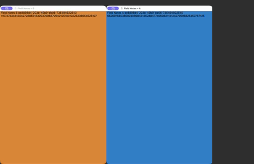
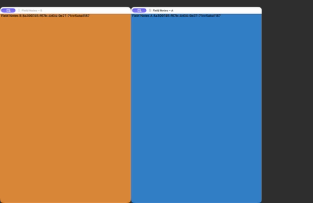

# 同屏拖放与切窗实测

## 最终签名候选 f7997a7

Nearpane 5.22（90）在 macOS 27.0（26A428）单块 1470 × 956 点显示器完成正式安装验收。测试临时关闭台前调度，在一个已登记的普通桌面使用独立签名的文档窗口。每次安装事务结束后都恢复了原 App、配置与桌面。

在生产侧栏把 A 卡拖到 B 卡的右半，A 到右边；拖到 B 卡的左半，A 到左边。两个槽位分别为 (0, 33, 615, 923) 和 (615, 33, 615, 923)。每次都核对了两个原窗口的 AX 和 WindowServer 坐标两次。鼠标松开至首次读回目标几何，右拖为 1.86 秒，反向左拖为 1.64 秒。自投期间及结束后均保持原位。两款独立签名应用之间的一次右拖也在原显示器、原桌面读回相同几何。[正式安装及逐动作收据](final-installed/pair-pointer.json) · [跨应用原件](final-cross/result.json) · [系统设置与日常安装恢复](final-cross/protected-installation.json)

| 普通启动的实测项目 | 旧签名版 d81c458 | 中间候选 d277a1c | 最终候选 f7997a7 |
| --- | ---: | ---: | ---: |
| 唯一输入落到目标编辑器 | 10/10 | 10/10 | 10/10 |
| 屏幕观测到目标窗口首帧 | 10/10 | 10/10 | 10/10 |
| 鼠标松开至系统焦点，中位区间 | 320–335 ms | 258–285 ms | 105–124 ms |
| 鼠标松开至目标首帧，中位区间 | 358–378 ms | 300–320 ms | 139–159 ms |
| 鼠标松开至目标首帧，P95 区间 | 374–394 ms | 336–356 ms | 169–188 ms |

最终候选首击的目标首帧在 147–166 ms，后九次的中位区间为 137–157 ms。各批使用同一版本的独立观察器和相同的两窗布局。上下界来自实际样本分别计算，覆盖鼠标松开至焦点或显示帧的测量误差。系统调度中心的同条件对照、全屏 Split View 和多屏性能仍待验。[十次逐帧数据与分阶段对照](display-focus-comparison.json)

生产 Host 对当前单屏普通桌面的明确选窗复用已选窗口的身份，只读核对窗口所属进程及生辰、AX 对象、CG 窗口号、显示器和 Space。此前已验证候选中，点击到首条 AX 指令的中位耗时为 258 ms，此次为 99 ms。旧拖放入口曾受跨桌面迁窗能力开关限制，现有同屏拖放独立完成两扇窗的布局事务。安装版的预检诊断先只读核实两扇窗，各得到 33 项结果，AX 写入为零，随后才执行真实点击。上表使用另一次普通启动的结果。[只读预检](verified-scope-diagnostic/focus-scope-probe.json) · [普通启动生产时序](final-installed/protected-installation.json) · [本机回归](integrated-offline.json)

截图取自 3.10 秒右拖录屏的 3.03 秒处。录像只纳入两个夹具的真实窗口，最右侧为侧栏预留区域。[原始 MP4](final-installed/right-drag-fixture-windows.mp4) · [呈现时戳及 44 帧编码记录](final-installed/right-drag-film.json) · [签名包与独立下载散列](../5.22-p6/integrated-f7997a7/draft-asset.json)

本机 628 项 Swift 测试、317 项加载历史原件的 Python 测试通过。托管 macOS 26 从 GitHub 草稿取回同一个压缩包，确认 13 个 Developer ID 签名对象、18 个架构切片。实体 macOS 27 和托管 macOS 26 均报告缺少公证票据，干净设备安装、首启及在线升级仍待验。正式验收结束后 Launch Services 只登记了日常安装，运行进程与原签名一致。[机器摘要与还原](final-acceptance.json) · [托管 macOS 验证](../5.22-p6/integrated-f7997a7/hosted-macos-26.json) · [原生 CI](https://github.com/haohongfei2001-png/nearpane/actions/runs/44837999301)

## 同屏分屏

签名构建 `203e34e` 保持 5.22（90）。在正式侧栏，拖动 A 的卡片到 B 卡的右半时，B 在左、A 在右；拖到左半时，A 在左、B 在右。边框均使用全局逻辑点。

| 动作 | 实际 A 矩形 (x, y, w, h) | 实际 B 矩形 (x, y, w, h) | 结果 |
| --- | --- | --- | --- |
| 拖回 A 本身 | (555, 392, 320, 193) | (585, 367, 320, 193) | PASS，自拖过程中及结束后均保持原位 |
| A 拖到 B 右侧 | (615, 33, 615, 923) | (0, 33, 615, 923) | PASS |
| A 拖到 B 左侧 | (0, 33, 615, 923) | (615, 33, 615, 923) | PASS |

两次有效排布均由 Host 报告 `pairVerified`，并分别得到两次互相一致的系统 AX 和 WindowServer 读回。相邻边界为 x = 615，侧栏占用最右 240 点。右拖在放开后 1.92 秒首次被独立读回为目标几何，左拖为 1.60 秒，读回时间含采样开销。[逐动作 JSON](binding-drag/pair-pointer.json) · [正式 Host 日志与恢复](binding-drag/protected-installation.json)

无声录像保留两扇测试窗和不透明底色。它包含从初始重叠到最终并排的 46 帧，时长 3.22 秒。鼠标事件与生产侧栏归属另由时间戳和 PID 收件确认。[实机 MP4](binding-drag/right-drag-fixture-windows.mp4) · [帧与动作时间](binding-drag/right-drag-film.json) · [A 窗原图](binding-drag/paired-ordinary-window-A.png) · [B 窗原图](binding-drag/paired-ordinary-window-B.png)

## 入场失败及中间候选

| 试次 | 实机证据 |
| --- | --- |
| 旧版 `d81c458` 首轮 | 观察器记录了点击，未取得目标键盘焦点。该版发送器未保存时间戳与 Host 收件，无法归因。修正读取器后，旧版真实鼠标输入 10/10。[首轮](baseline/pair-pointer.json) · [受控复测](baseline-routed/pair-pointer.json) |
| `e3c4d16` 初版拖放 | 在正确面板收到 down、9 段 drag 和 up 后，两份窗的坐标都未改变，右拖 FAIL。[收件与几何](current-drag/pair-pointer.json) |
| `6c5b4a1` 面板入口 | 命中检查遇到系统光标层级，当时未能证明遮挡者身份，实际派发 0 次，BLOCKED。[入场读回](panel-drag/pair-pointer.json) |
| `7ad17dc` | 右拖到达生产操作，启动了同包签名控制器。旧验收器在放开后约 0.94 秒丢失卡片读回并清理，最终几何 UNKNOWN。独立聚焦试次在 Launch Services 短暂无法确认时结束，实际点击 0 次。[拖放](bounded-drag/pair-pointer.json) · [点击前拒绝](measured-focus/pair-pointer.json) |
| `203e34e` 的画面观察 | 10 次鼠标选择和唯一键盘标记通过，画面观察在读全桌面时中止。只接受真实可见目标帧，保留 UNKNOWN。[输入](binding-focus/pair-pointer.json) |

对旧版的独立鼠标复测，把全桌面库存检查收窄为真实采样区域后，10 次都收到了显示流，但 9 次无法确认固定尺寸色块，1 次缺少呈现时钟的前后见证。10 对键盘标记仍然全部正确。每份原始画面收据均已保留。[旧版同屏实测](original-display-focus/pair-pointer.json)

## 首轮切窗提速

同一台 Mac 上，旧签名包 `d81c458` 的鼠标释放到确认目标焦点的区间中位数为 320–347 毫秒。`d277a1c` 的独立读回为 257–288 毫秒，两组均为 10/10 次唯一输入。带同包日志的前一候选 `203e34e`，从正式卡片收到点击到首条 AX 指令中位数为 311 毫秒；`d277a1c` 为 259 毫秒。原始显示样本仅获得源窗口色，目标画面首次可见的时间未知。[分项测量](installed-focus-comparison.json) · [d277a1c 同包交互与画面](final-pair/pair-pointer.json) · [d277a1c 右拖录像](final-pair/right-drag-fixture-windows.mp4)

## 两个应用与实机显示基线

`d277a1c` 已在同一已登记桌面上对两款不同 bundle ID、不同 PID 和签名散列的 AppKit 程序完成一次真实侧栏右拖。被拖窗口 A 最终为 (615, 33, 615, 923)，另一个进程的 B 为 (0, 33, 615, 923)。两次独立 AX/CG 读回及两个进程的清理均通过。[跨应用收据](separate-applications/result.json) · [日常配置恢复](separate-applications/protected-installation.json)

修正观察器后，同一台 Mac 上的旧签名候选 `d81c458` 有 10/10 次取得目标窗口真实呈现。鼠标松开到第一帧目标画面的区间中位数为 358–378 毫秒。通过每帧窗口系统时间、独立遮挡检查以及 64 个实际目标色像素确定该区间。[实机读取与十次输入](baseline-presented/pair-pointer.json)

## 定向读回的第一次实机试验

`d1e0361` 在首击绑定目标后报告 `targetScopeChanged`。生产助手向目标发出的置前指令为零，独立观察器没有读到目标焦点或目标画面，未输入标记。此轮选窗合同 FAIL，剩余九次未执行。该包在同一安装期内自投、右拖通过，紧接着的左拖到达 `pairPlacing`，六次系统采样均未见预期交换，左拖 FAIL。初次收据的粒度不足以确定哪项定向检查发生冲突。测试结束后日常应用与配置已恢复。[逐项系统读回](scoped-final/pair-pointer.json) · [生产 Host 时序与恢复](scoped-final/protected-installation.json) · [独立签名归档](../5.22-p6/integrated-d1e0361/installation-result.json)

该源码的本机 Swift 测试 625 项、加载历史原件的 Python 验收测试 305 项均通过。前一轮托管 macOS 26 曾暴露一项测试把时钟延迟误当作执行顺序的问题，新用例显式等待首次读取完成。[本机回归与原 CI 失败](targeted-focus-regression.json)

## 已通过候选的同条件首帧测量

同一台 Mac、同一桌面、同两扇签名夹具窗口和同一版显示观察器。两批各十次鼠标松开，均确认了唯一输入落点和目标画面的首次真实呈现。下表取分别计算的下界、上界中位数，单位为毫秒。

| 签名源码 | 系统键盘焦点 | 屏幕首次呈现目标窗口 | 首击呈现 | 后九次呈现中位区间 |
| --- | --- | --- | --- | --- |
| `d81c458` | 320–335 | 358–378 | 208–228 | 359–379 |
| `d277a1c` | 258–285 | 300–320 | 160–180 | 307–328 |

真实首帧区间的两个中位端点均缩短约 58 ms。每次用显示流的实际像素、呈现时间戳和原绑定窗口的前后层序取证。该对照只测当前普通桌面上两窗置前，系统调度中心的同条件基准尚缺。[旧版](baseline-presented/pair-pointer.json) · [通过候选](accepted-presented/pair-pointer.json) · [十次样本、P95、首击及后九次](display-focus-comparison.json)

`d277a1c` 的 3.50 秒真实右拖视频在 3.43 秒处显示橙色 B 窗在左、蓝色 A 窗在右。捕获范围仅含已登记的两扇窗口，侧栏预留区以不透明底色呈现。[实机截图](right-drag-d277a1c.png) · [视频](final-pair/right-drag-fixture-windows.mp4) · [视频时间点与散列](right-drag-d277a1c-frame.json)
