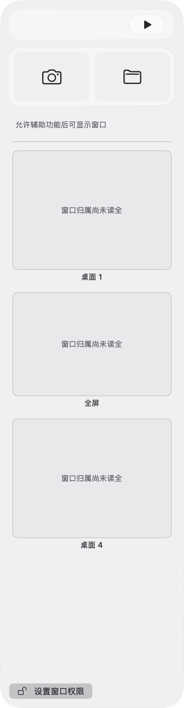

# Nearpane 5.22（91）权限与覆盖升级实测

2026-11-20 在 Apple Silicon Mac、macOS 27.0（26A428）上，从当前 R4 草稿下载候选包，将正在使用的 `/Applications/Nearpane.app` 从 90 原位升级为 91。安装后，Launch Services 只登记这一份 Nearpane。源码为 `687fd7119dbc1cf182f237b1226806e114c62220`。[候选下载](https://github.com/haohongfei2001-png/nearpane/releases/tag/untagged-c9723598de5994fe9db1) · [机器可读验收记录](verification.json)

| 检查 | 实测结果 |
| --- | --- |
| 旧开关打开但权限失效 | 设备控制、录屏原有记录都为允许，各自要求一个旧构建的代码哈希。build 90 对两条要求均不匹配，运行中的 Nearpane 对两项权限的读数均为关闭。 |
| 修复导出入口 | 直接安装和导出都生成 `Nearpane.app`，均要求团队 `ZB9D4T66QB` 的 Developer ID Application 签名。单独复现了导出到空目录的情况。改用临时签名的副本即使通过严格完整性校验，也被导出工具拒绝，目标目录没有生成 App 或收据。 |
| 跨版本身份 | 86、88、89 均与 90 的主程序及七个助手分别双向匹配。GitHub 下载的 91 与已安装的 90 再通过 16 次双向检查。两版主程序的代码哈希不同，系统指定的签名要求相同。 |
| 真实升级 | GitHub 附件 24,439,269 字节，SHA-256 为 `f37b0ec0dadc3f5ac218da0cffefbef72e178123699dfbc5eed590545989cb26`。正常退出 90 后，在原路径原子替换，从 Launch Services 启动 91。运行映像与安装文件一致。资料索引摘要、资料根目录和各资料代际均与升级前一致。 |
| 旧版本清理 | 清理旧安装包、回退包、开发副本，以及废纸篓中有清单可核对的旧产物。三个没有 `.app` 后缀的早期完整应用也已移除。应用目录、下载、文稿、项目、可读临时区和废纸篓复扫只找到当前 App 及一份 91 ZIP。R4 草稿只提供 91。 |
| 系统权限 | 用 macOS 自带的 `tccutil` 仅清除 Nearpane 的两条旧记录。macOS 要求本机账户身份验证。设备控制随后记录了匹配 90 和 91 的新签名要求，记录值为未允许。录屏没有允许记录。升级后从正式 Host 直接查询，辅助功能、录屏和事件投递均为关闭。 |
| 真实窗口能力 | 91 的侧栏与系统目录都枚举出 4 个桌面或全屏空间，选中项一致。动作助手报告切换与迁移均不可用。精确键盘聚焦、真实切换、跨桌面迁移及正式 App 的逐窗像素仍待权限放行。 |
| 回归测试 | 516 项 Swift 集成测试、8 项候选身份测试、4 项更新组件测试、5 项图标测试、21 项 Native Spaces 验收程序测试通过。 |

**授权后的自动继承仍待实测。** 本次升级开始时两项权限均未放行，实测证明了签名连续性和已存在的设备控制决定跨升级保持一致。公开 Sparkle 通道尚未配置发布公钥，下载验收使用当前 GitHub 草稿中的实际 ZIP。[Apple 关于跨版本授权身份的说明](https://developer.apple.com/documentation/technotes/tn3127-inside-code-signing-requirements/)

下图是升级后由 WindowServer 单独截取的正式 Nearpane 侧栏，保留当时的权限提示和窗口归属未知状态。

