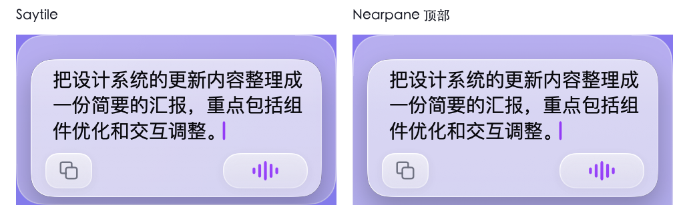
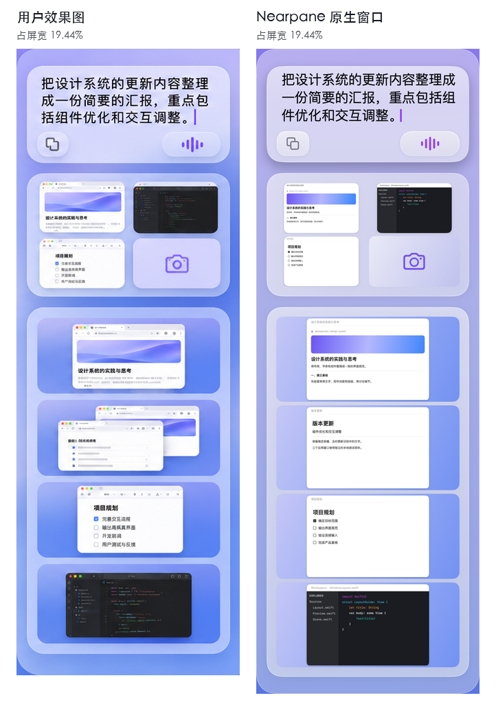

# 语音板及桌面侧栏原生对照

本轮分支从 Nearpane PR #7 的 `f9671d15` 接续。Saytile 共享视图锁定在 `d3ddafcd4d410fc763ae2a5badfaefa21ceb48fc`，七个受校验文件的树 SHA-256 为 `7f5771aae9c51d27b9285b5b311bec1f6103359feb64ae6e4459954bbfff69b7`。识别和 Riftlet 队列继续使用各自原有的固定源码及资料库。

用户提供的桌面效果图为 1672 × 941 px，SHA-256 为 `c15bc20b8bd33e1f99f21638b81234748d1e17f2c3aefea518d9c2989e750ca2`。右侧外框约 325 px，内卡左右各退约 15 px。语音槽高 173 px、托盘槽高 195 px，按可用高度约束。默认产品外宽取可用屏宽的 12.5%，效果图构图的外宽约为 19.4%。缩略图始终保持图像原始宽高比。

## 运行行为

- 完整侧栏与独立 Saytile 共用外框、语音卡、文字及两个控件。显示器位置、已保存的用户高度和独立 App 身份继续由宿主管理。
- 截图托盘从 Riftlet 真队列显示缩略图及相机入口。空间区按已确认的窗口位置绘制。缺少 Space 归属证据时可只读浏览当前显示器的实际窗口。
- 每个显示器可单独开启窗口内容预览。开启后须有 macOS 屏幕录制权限才读取单窗图像。只在内存中保留缩略图。关闭时可从真实应用图标与已观察的窗口几何辨识窗口。

## 最终实机收据

双宿主实拍使用 Nearpane `044b659f64146db0832f7c45a2d232512d7ddba5`。后续 `ee55420` 拆分了合成桌面测试数据的编译表达式，原生窗口验收使用 WindowServer 观察资料。同一台 Mac 的可用屏幕为 1920 × 1080 pt，WindowServer 使用 2× 像素。默认两个外框均为 240 pt 宽，语音槽均为 128 pt 高，内卡均为 217.85 × 103.63 pt。两个宿主在暂停、待命和讲话三态均测得相同的内卡边界。另用临时显示器配置把外宽置为效果图的占屏比例，分别采集参考构图与实际出厂宽度。

| 项目 | 实际结果 |
| --- | --- |
| 隔离的完整 macOS 套件 | PASS，314/314（52 组）。Host-only 套件 251/251（41 组）。 |
| 三态几何与材质对照 | PASS，内卡边界各坐标相差 0 pt，各个通道的三态平均绝对像素差低于 2/255。 |
| 可选文字流、复制选区/组、底部控件 | PASS，读取实际窗口的 AX 与隔离剪贴板。 |
| 托盘与工作区 | PASS，3 个已导入 Riftlet 的真实图像及相机槽。4 个验收进程拥有的窗口内容经过只读桌面投影；此场景未见证独立 Space，不作为跨 Space 切换证明。 |
| 主观视觉批准 | 待用户判断。实机使用真实系统字体及独立测试内容，取图时窗口排列、壁纸与参考内容有差异。 |
| 用户生产安装、私人窗口/语音、新硬件显示器、发布 | NOT_RUN。本次测试运行临时构建及隔离资料。 |

[测试数量、最终源码与日志摘要](native-tests.json) · [WindowServer、可访问性、前台窗口与像素比对](comparison.json) · [参考构图测量](reference-metrics.json)
